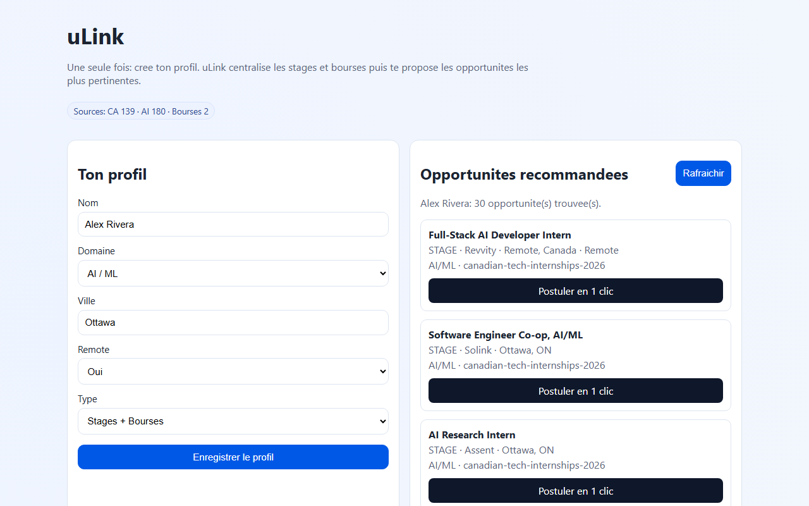
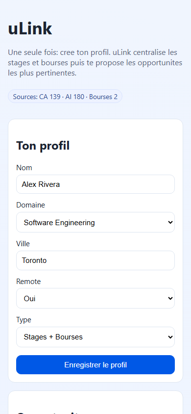
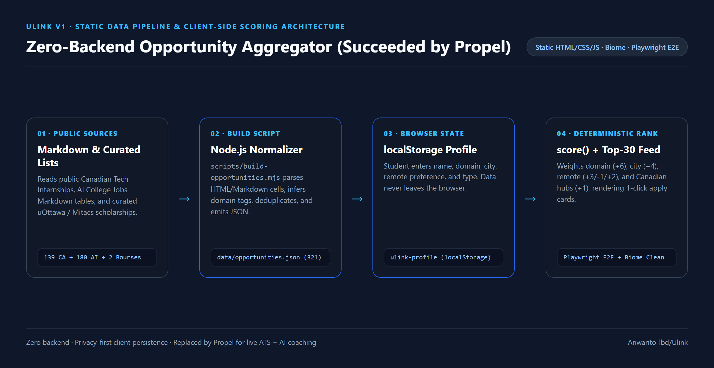

> **Ulink v1 — Succeeded by [Propel](https://github.com/Anwarito-lbd/propel)**
>
> *Ulink v1 was the initial zero-backend static prototype that validated student profile matching against Canadian internship and scholarship lists. It has been succeeded by **[Propel](https://github.com/Anwarito-lbd/propel)**, a full-stack career workspace powered by Next.js 16, React 19, Vinext, Drizzle ORM, Cloudflare Workers (D1 + R2), FastAPI, live ATS/Job Bank feeds, and fact-safe Gemini CV/interview coaching.*

# uLink

Students waste hours searching for the same internships and scholarships over and over. With uLink a student builds a profile once and gets the most relevant opportunities matched to it directly in the browser.

_Version française : uLink répond au problème de recherche longue et répétée de stages et de bourses._

---

## Live Demo & Visual Proof

### Walkthrough Preview


- Full screen-recorded walkthrough video: [docs/images/ulink-walkthrough.mp4](docs/images/ulink-walkthrough.mp4)

### Desktop & Mobile UI
| Desktop (`1280×800`) | Mobile (`390×844`) |
| :---: | :---: |
|  |  |

---

## Architecture & Data Flow



```
external lists (Markdown)  ──►  scripts/build-opportunities.mjs  ──►  data/opportunities.json (321 items)
                                                                            │
                                                   index.html + app.js  ◄───┘  (static, localStorage-only)
```

---

## How It Works

1. **Collect & Normalize (`scripts/build-opportunities.mjs`):** Parses public Canadian tech internship and AI college job Markdown tables plus curated uOttawa/Mitacs scholarships into a single normalized schema (`title`, `company`, `domain`, `location`, `remote`, `type`, `url`) in `data/opportunities.json` (321 total entries: 139 Canadian internships, 180 AI jobs, 2 curated scholarships).
2. **Store Locally:** The static JSON payload is served directly—no database or backend server required.
3. **Profile (`localStorage`):** The student fills in a short profile form (name, domain, city, remote preference, opportunity type). The profile persists solely in browser `localStorage` (`ulink-profile`).
4. **Deterministic Score (`score()` in `app.js`):** Scores domain match (`+6`), city match (`+4`), remote preference (`+3`/`-1`/`+2`), and Canadian tech hubs (`+1`), filters out unselected types, and renders the top 30 ranked matches.

---

## Tools, Skills, AI Models & Engineering Stack

- **Frontend & Scoring:** Vanilla JavaScript (`ES Modules`, `localStorage`), semantic HTML5 (`<template>`), responsive CSS Grid (`styles.css`).
- **Data Build & Local Serving:** Node.js (`scripts/build-opportunities.mjs`, `scripts/serve.mjs` cross-platform HTTP server).
- **AI / LLM Models Used:** None in v1 (scoring and domain classification are 100% deterministic rule-based heuristics; AI resume parsing, grounded CV tailoring, and mock interview coaching were introduced in the successor, [Propel](https://github.com/Anwarito-lbd/propel)).
- **Testing & Quality Tooling:** `@playwright/test` (`1.57.0`) for end-to-end browser verification, `@biomejs/biome` (`2.4.9`) for linting and formatting, `node --check` for syntax validation, `Taskfile.yml`, `mise.toml`, and `lefthook.yml`.

---

## Project Structure

| Path | Purpose |
|---|---|
| `index.html`, `styles.css`, `app.js` | Static web app: profile form, deterministic scoring, and ranked feed |
| `scripts/build-opportunities.mjs` | Markdown-to-JSON normalization pipeline |
| `scripts/serve.mjs` | Cross-platform Node.js static server for local dev and E2E tests |
| `data/opportunities.json` | Pre-built dataset of 321 normalized internships and scholarships |
| `tests/ulink.spec.js` | Playwright end-to-end tests (profile submission, persistence, scholarship filtering) |
| `docs/PROOF_OF_WORK.md` | Exact observed test, lint, and visual verification outputs |
| `Taskfile.yml`, `lefthook.yml`, `biome.json`, `mise.toml` | Task shortcuts, git hooks, Biome config, and runtime pinning |

---

## Local Setup & Verification

```bash
npm install
npx playwright install chromium   # first time only
node scripts/serve.mjs            # or: task dev
```

Open `http://127.0.0.1:5173`.

Run quality checks and end-to-end tests:

```bash
npm run lint       # biome check .
npm run check:js   # node --check app.js
npm run test:e2e   # playwright test
```

To regenerate `data/opportunities.json`, clone the upstream Markdown lists next to this repo (`../Canadian-Tech-Internships-2026` and `../2026-AI-College-Jobs`) and run `npm run build:data`.
